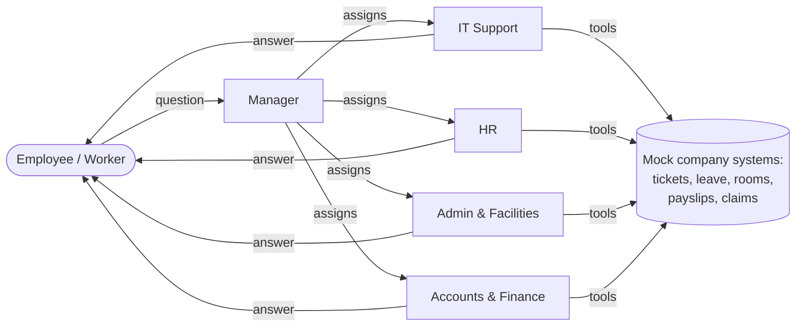

# Acme Employee Help Desk: a 5-agent AutoGen support chatbot

An employee (the **Worker**) asks a question in a Streamlit chat. A **Manager** agent triages it and assigns it to one of four department agents: **IT**, **HR**, **Admin** or **Accounts**. Each department agent has its own tools, memory and instructions, and answers the employee directly.

Built with **AutoGen AgentChat 0.7** and OpenAI models. The company, employees and systems are fictional mock data, so the app runs anywhere.



| Agent | Handles | Tools |
|---|---|---|
| 👔 Manager | Triage and assignment | Handoffs or structured routing (depends on mode) |
| 💻 IT Support | Passwords, VPN, laptops, software, security incidents | `check_system_status`, `reset_password`, `request_software`, `list_my_assets` |
| 🤝 HR | Leave, holidays, policies, benefits | `get_leave_balance`, `apply_leave`, `get_holiday_calendar`, `get_my_profile` |
| 🏢 Admin & Facilities | Meeting rooms, ID cards, supplies | `find_available_rooms`, `book_meeting_room`, `request_access_card`, `request_office_supplies` |
| 💰 Accounts & Finance | Payslips, expense claims, tax | `get_payslip`, `list_expense_claims`, `submit_expense_claim` |

Every department also has `search_knowledge_base`, `create_ticket` and `list_my_tickets`.

The sidebar switches between three ways for the Manager to assign work, using the same five agents:

| Mode | AutoGen team | How the Manager assigns work |
|---|---|---|
| Swarm · handoffs | `Swarm` | Calls a `transfer_to_<department>` handoff tool. The department keeps the conversation until it hands back. |
| Selector group chat | `SelectorGroupChat` | Writes a `ROUTE_TO: <agent>` note; a selector model picks the department. |
| GraphFlow · structured routing | `GraphFlow` | Returns a typed `RoutingDecision`; conditional graph edges start one or more departments **in parallel**. |

---

## Part 1: Run it, step by step

**Step 1. Open a terminal in the project folder and activate the virtual environment**

```powershell
cd "C:\GEN AI\Autogen\SE-AI-B12-W5-D3-Multiagent-SEO"
.\venv\Scripts\Activate.ps1
```

**Step 2. Install the dependencies**

```powershell
pip install -r customer_support_bot\requirements.txt
```

**Step 3. Add your OpenAI key**

The app reads `OPENAI_API_KEY` and `OPENAI_MODEL` from the parent folder's `.env`, which already exists. To use a different key for this app only, copy `.env.example` to `customer_support_bot\.env` and fill it in.

**Step 4. Check the install without spending tokens**

```powershell
cd customer_support_bot
python offline_check.py
```

This runs the real Swarm, Selector and GraphFlow teams with AutoGen's `ReplayChatCompletionClient` (scripted model replies, no API calls). It should end with `All offline checks passed.`

**Step 5. Start the Streamlit app**

```powershell
streamlit run app.py
```

Open http://localhost:8501, pick an employee and a mode in the sidebar, and click one of the example questions.

**Step 6 (optional). Use the terminal version**

```powershell
python cli.py --mode graph --employee EMP1002
```

---

## Part 2: How it's built, step by step

Each step is one file in `support_desk/`. Read them in this order.

### Step 1. Model client (`config.py`)

```python
OpenAIChatCompletionClient(model="gpt-4.1-mini", temperature=0.2, stream_options={"include_usage": True})
```

There are two clients per turn: a **streaming** one (it asks OpenAI to include token usage in the stream) for agents that stream tokens, and a **plain** one for structured output and speaker selection. `config.py` also defines the settings, the three `Orchestration` modes and the log file setup.

### Step 2. Mock company systems (`data/`, `data_store.py`)

`company_data.json` holds employees, systems, rooms, holidays and expense claims. `knowledge_base.json` holds 21 help articles. Anything the agents create (tickets, leave requests, bookings, claims) is written to `data/runtime_store.json`.

### Step 3. Tools (`tools.py`)

Each department gets a list of `FunctionTool`s. The tools are **closures bound to the signed-in employee**, so the model never passes an employee ID and can't touch anyone else's data:

```python
def _hr_tools(employee):
    def get_leave_balance() -> str:
        return _json(db.leave_balance(employee))
    ...
    return [FunctionTool(get_leave_balance, description="Get the employee's leave balance."), ...]
```

Parameters use `Annotated[...]` and `Literal[...]`, so the model sees descriptions and allowed values. The tools validate everything themselves (dates, weekends, overlaps, expense limits) and return errors as JSON.

### Step 4. Memory (`memory.py`)

Each agent gets a `ListMemory` with the employee's profile plus that department's standing policies. AutoGen injects it into the model context before every reply and emits a `MemoryQueryEvent`, which the UI shows.

### Step 5. Prompts (`prompts.py`)

System messages share common rules (today's date, no invented facts, privacy, no passwords). The Manager's instructions change with the mode: use transfer tools in Swarm, write a `ROUTE_TO:` line in Selector mode, or fill in a `RoutingDecision` in GraphFlow.

### Step 6. Agents (`agents.py`)

All five are `AssistantAgent`s:

```python
AssistantAgent(
    name="HR_Support",
    model_client=clients.stream, model_client_stream=True,   # token streaming
    tools=build_tools("HR", employee),
    reflect_on_tool_use=True, max_tool_iterations=4,          # several tool rounds, then a plain answer
    memory=[build_memory(employee, "HR")],
    model_context=BufferedChatCompletionContext(buffer_size=30),
    handoffs=[Handoff(target="Manager", ...)],                # Swarm mode only
)
```

In GraphFlow mode the Manager uses `output_content_type=RoutingDecision` (structured output), so its reply is a `StructuredMessage[RoutingDecision]`.

### Step 7. Teams and termination (`teams.py`)

- **Swarm:** handoffs move the conversation. The run stops when any agent writes a plain `TextMessage`, using one `TextMessageTermination(source=...)` per agent. Each condition is tied to an agent because the employee's own message is a `TextMessage` too, and AutoGen checks the task message against termination.
- **SelectorGroupChat:** `selector_func` sends every new employee message to the Manager. `candidate_func` limits the selector model's choice to departments. `emit_team_events=True` streams `SelectSpeakerEvent`. The run stops with `SourceMatchTermination(departments)` or `TextMentionTermination("NEED_INFO", sources=["Manager"])`.
- **GraphFlow:** a `DiGraphBuilder` connects the Manager to each department with a **callable edge condition** (`"HR" in decision.departments`). If several departments match, they run in parallel. If none match (a greeting or clarifying question), the graph ends after the Manager.
  - AutoGen 0.7.5 needs the concrete `StructuredMessage[RoutingDecision]` type passed to `custom_message_types`; without it, GraphFlow fails with "Message type ... is not registered".
- All modes add safety limits: `MaxMessageTermination | TimeoutTermination | TokenUsageTermination`.

### Step 8. One turn with saved state (`runner.py`)

Streamlit re-runs the whole script on every click, so the app doesn't keep a live team. Each turn it:

1. builds a fresh team,
2. calls `await team.load_state(previous_state)`,
3. streams `team.run_stream(task=message)`,
4. stores `await team.save_state()` for the next turn.

This is AutoGen's human-in-the-loop pattern for web apps: a run ends when an agent replies, and the next message resumes the team. The same state is saved in `sessions/*.json`, so conversations can be resumed after a restart.

### Step 9. Streamlit front end (`app.py`)

- **Help Desk Chat:** the five-agent roster, example questions, and live rendering of every stream event: token chunks, handoffs, routing decisions, tool calls with arguments and results, memory lookups and speaker selection. Each answer gets 👍/👎 feedback.
- **My Tickets & Requests:** everything the agents created, read from the runtime store.
- **Insights:** turns, tokens, response time, helpful rating, requests per department and tokens per agent.
- **How It Works:** the flow diagram for the current mode, the feature map, and every agent's system message.
- **Sidebar:** simulated sign-in (three employees), mode, model and safety limits, saved conversations, and *Export team config*, which uses `team.dump_component()` (the API key isn't included).

### Step 10. Terminal version and offline check

`cli.py` keeps one live team and prints with AutoGen's `Console(team.run_stream(...), output_stats=True)`. `offline_check.py` runs scripted replies through all three modes to catch wiring errors without an API key.

---

## Part 3: Things to try

| Ask | What to watch |
|---|---|
| "My VPN keeps disconnecting since this morning." | IT checks system status first and reports the known incident with its workaround. |
| "How many annual leave days do I have left? I'd like Nov 5 to 6 off." | HR checks the balance, then applies for leave and returns an `LV-` request ID. |
| "Book a meeting room for 6 people next Tuesday from 3 to 4 pm." | Admin converts the date, finds free rooms, and books one (`BK-` ID). |
| "I clicked a link in a suspicious email and typed my password." | Urgent route to IT: password reset link plus an urgent ticket. |
| "I lost my ID card, and when is the next company holiday?" | **GraphFlow:** Admin and HR answer in parallel. **Swarm:** Admin answers its part, then hands you back to the Manager when you reply "next". |
| "Show me Rahul's payslip." | Refused: tools only work for the signed-in employee. |

Afterwards, open **My Tickets & Requests** to see the records the agents created.

## Part 4: AutoGen feature map

| Feature | Where |
|---|---|
| `AssistantAgent` (5 agents) | `support_desk/agents.py` |
| `OpenAIChatCompletionClient`, token streaming | `support_desk/config.py`, `agents.py` |
| `FunctionTool`, `reflect_on_tool_use`, `max_tool_iterations` | `support_desk/tools.py`, `agents.py` |
| `Handoff`, `Swarm` | `support_desk/agents.py`, `teams.py` |
| `SelectorGroupChat` (`selector_prompt`, `selector_func`, `candidate_func`, `emit_team_events`) | `support_desk/teams.py` |
| `GraphFlow`, `DiGraphBuilder`, callable edge conditions, parallel branches | `support_desk/teams.py` |
| Structured output (`output_content_type`, `StructuredMessage`) | `support_desk/schemas.py`, `agents.py` |
| `ListMemory`, `MemoryContent` | `support_desk/memory.py` |
| `BufferedChatCompletionContext` | `support_desk/agents.py` |
| Termination: `TextMessage`, `SourceMatch`, `TextMention`, `MaxMessage`, `Timeout`, `TokenUsage`, combined with `\|` | `support_desk/teams.py` |
| Human in the loop (stop on reply, resume on next message) | `support_desk/runner.py`, `app.py`, `cli.py` |
| `save_state` / `load_state` | `support_desk/runner.py`, `app.py`, `cli.py` |
| `run_stream` events (chunks, tool calls, handoffs, memory, speaker selection) | `app.py` |
| Declarative config (`dump_component`) | `app.py` sidebar |
| Event logging, `models_usage`, `total_usage()` | `support_desk/config.py`, `runner.py`, `app.py` |
| `Console` UI | `cli.py` |
| `ReplayChatCompletionClient` (testing without an API) | `offline_check.py` |

## Project structure

```
customer_support_bot/
├── app.py                  Streamlit front end (4 pages)
├── cli.py                  Terminal version (AutoGen Console)
├── offline_check.py        No-cost check of all three teams
├── requirements.txt
├── .env.example
├── data/
│   ├── company_data.json   Employees, systems, rooms, holidays, claims
│   └── knowledge_base.json Help articles for each department
└── support_desk/
    ├── config.py           Settings, modes, model clients, logging
    ├── departments.py      The roster: Manager + 4 departments
    ├── data_store.py       Mock company systems and JSON store
    ├── tools.py            18 employee-scoped FunctionTools
    ├── memory.py           ListMemory: profile + policies
    ├── prompts.py          System messages for each mode
    ├── schemas.py          RoutingDecision (structured output)
    ├── agents.py           The 5 AssistantAgents
    ├── teams.py            Swarm / Selector / GraphFlow + termination
    └── runner.py           One turn: load_state, run_stream, save_state
```

Created at runtime (and git-ignored): `data/runtime_store.json`, `sessions/`, `logs/autogen_events.log`.

## Troubleshooting

- **"OpenAI rejected the API key"**: check `OPENAI_API_KEY` in `.env`, then restart Streamlit.
- **A model name AutoGen doesn't know**: the app falls back to a generic model profile. Pick a listed model if tool calls or structured output misbehave.
- **Swarm keeps talking to the same department**: that's how Swarm works; the department owns the chat until it hands back. Say "next", or ask about another department's topic. Use GraphFlow for multi-department questions in a single turn.
- **Stopped by a safety limit**: raise the limits under *Model and safety limits* in the sidebar.
- **Reset the demo data**: delete `data/runtime_store.json` and the `sessions/` folder.
- **See every LLM call**: `logs/autogen_events.log` holds AutoGen's event log, including full prompts.

## Extend it: add a department (for example, Legal)

1. Add a `Department(...)` entry in `support_desk/departments.py`.
2. Write a `_legal_tools(employee)` builder in `tools.py` and register it in `_DEPARTMENT_TOOLS`.
3. Add `"Legal"` policies to `POLICIES` in `memory.py`.
4. Add `"Legal"` to the `departments` literal in `schemas.py`.
5. Add knowledge-base articles with `"department": "Legal"`.

The Manager's prompt, the Swarm handoffs, the selector candidates and the GraphFlow edges are all generated from the roster, so they pick up the new department automatically.
